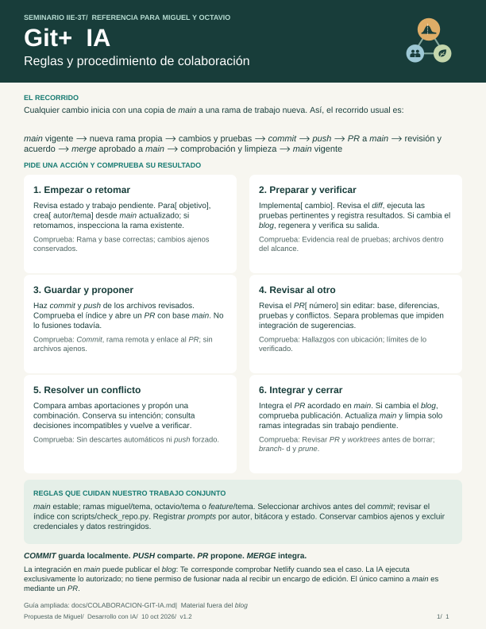

[Todas las ayudas: Tutoriales y fichas](tutoriales.qmd)

**Objetivo:** guardar un cambio verificable en tu carpeta y distinguirlo de compartir o integrar una contribución. Esta guía acompaña [Preparar tu proyecto](../preparar-proyecto.qmd#inicia-el-control-de-versiones-local-con-git). Necesitas Git instalado y una carpeta propia con documentos de práctica; no uses datos sensibles.

## Empieza en tu equipo

**Git** conserva versiones locales. Un **commit** es una versión registrada de los archivos que seleccionaste. **GitHub** aloja un repositorio remoto para compartir trabajo; no necesitas una cuenta ni publicar nada en esta primera práctica.

Abre una terminal dentro de tu carpeta de práctica. Si aún no es un repositorio, ejecuta:

```bash
git init
git status
```

Edita una frase en `README.md`. Examina el estado y selecciona únicamente ese documento:

```bash
git status
git diff
git add README.md
git diff --cached
git commit -m "Describe el propósito del proyecto"
git log -1 --oneline
git status
```

En el primer registro, `git diff` no muestra el contenido de archivos nuevos sin seguimiento: revísalos en tu editor y confirma lo seleccionado con `git diff --cached`. Si Git solicita tu identidad o falta la instalación, anota el mensaje y pide acompañamiento. También puedes usar el panel de Git de RStudio u otro editor para revisar y registrar los archivos.

**Comprueba:** el mensaje aparece en el último commit y `README.md` ya no tiene cambios pendientes. Otros archivos pueden seguir pendientes; no los añadas para conseguir un estado limpio. Un commit local no es un respaldo en otro equipo.

## Más adelante: compartir con GitHub

Cuando el grupo acuerde colaborar sobre un repositorio compartido, necesitarás una cuenta y acceso al repositorio. Una **rama** separa una propuesta de la versión principal, `main`; un **pull request (PR)** pide revisar esa propuesta. **Push** envía commits al remoto; **merge** integra la contribución tras su revisión y autorización.

El recorrido del seminario es: revisar el estado → actualizar `main` por avance rápido → crear una rama → editar y comprobar → commit → push → PR hacia `main` → revisión → fusión autorizada.

Antes de cambiar de rama, conserva y aclara cualquier trabajo pendiente. Si `git pull --ff-only` informa que no puede avanzar, pide revisar la divergencia: no descartes cambios ni fuerces el envío. Un asistente puede ayudar a preparar la contribución; un encargo de edición no autoriza a fusionarla o publicarla.

## Encargo para pedir ayuda

```text
Ayúdame a guardar una versión de mi proyecto con Git.
Comprueba la carpeta, la rama y los archivos pendientes.
Explícame qué cambió y selecciona solo los documentos que acordemos.
Antes del commit, muéstrame el contenido seleccionado.
Después comprueba el último commit y los cambios que siguen pendientes.
No publiques, borres archivos ni descartes trabajo ajeno.
Si falta instalación, identidad o permisos, explica qué falta.
```

## Ficha de consulta: Git + IA {#ficha-de-consulta}

La ficha del equipo reúne seis encargos para trabajar con ramas, PR y revisiones. Fue preparada para Miguel y Octavio y se ofrece aquí como **referencia ampliada**: sus rutas y nombres de rama pertenecen al repositorio del seminario. No son tareas obligatorias para tu primer commit.

[Descargar la ficha en PDF (carta, una página)](git-ia-ficha.pdf){.btn .btn-primary} · [Abrir la imagen SVG ampliable](git-ia-ficha.svg)

{width=100%}

::: {.callout-note collapse="true"}
## Los seis casos, en texto

1. **Empezar o retomar:** comprobar rama, base y trabajo pendiente.
2. **Preparar y verificar:** limitar el cambio y conservar evidencia de las pruebas.
3. **Guardar y proponer:** registrar, enviar y abrir un PR con los archivos revisados.
4. **Revisar al otro:** explicar hallazgos y límites antes de aceptar la contribución.
5. **Resolver un conflicto:** comparar ambas aportaciones y conservar su intención.
6. **Integrar y cerrar:** fusionar con autorización, verificar la publicación cuando corresponda y conservar las ramas activas.
:::

**Pregunta de comprobación:** ¿hacer commit publica tu trabajo en GitHub? **Respuesta esperada:** no; registra una versión local. Compartir requiere un envío y los permisos correspondientes; integrar mediante un PR es otra decisión.

La ficha conserva su edición original v1.2 del 10 de octubre de 2026, incluida la indicación histórica «Material fuera del blog». Su distribución desde esta página se incorpora el 18 de noviembre de 2026 a petición de Miguel. La guía interna completa conserva su ubicación; no es necesaria para esta primera práctica.

Guía breve desarrollada con asistencia de IA, 18 de noviembre de 2026. La ficha procede de la propuesta de Miguel, desarrollada con asistencia de IA. La revisión editorial no acredita una prueba de aprendizaje con participantes.
